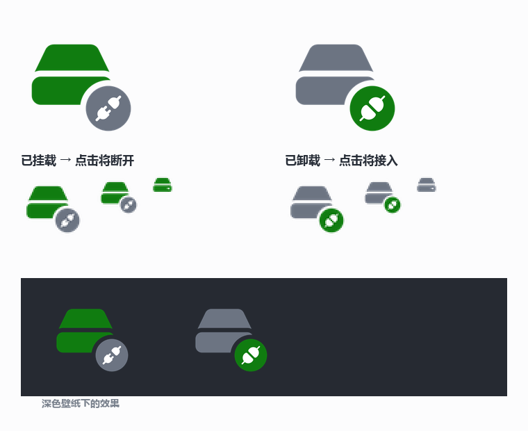

# D / F 盘开关 · Drive-Toggle

用桌面上的快捷方式，把**内置机械盘（D:）**和**移动硬盘（F:）**在「联机」和「脱机」之间切换。

脱机时，Windows 里根本没有这块盘（连盘符都不分配），任何程序、索引服务、杀毒软件都碰不到它，硬盘自然停转、不吵、不读。要用的时候点一下，几秒钟就回来。

---

## 1. 日常使用

**全程没有控制台窗口。** 点一下图标，弹出一个约 430×176 的小窗口，显示进度和结果，成功后 1.6 秒自动消失。

| 我想… | 点这个 | 结果 |
|---|---|---|
| **一起开关所有盘** | 桌面 **「硬盘开关」** | 当前在线就全部断开，当前脱机就全部接入 |
| **只开关某一块盘** | 桌面 **「硬盘开关 - D 盘」** | 只动这一块，其他盘不受影响 |

入口位置：**桌面上的快捷方式**。安装器只往桌面放，不往开始菜单装东西——
想固定到开始屏幕，右键快捷方式 →「固定到“开始”屏幕」，你自己决定。

> 「硬盘开关」是单按钮模式：图标颜色=当前状态（绿=已挂载 / 灰=已卸载），
> 右下角插头的**颜色和形状**=点击后的结果（灰+断开=点了会断，绿+接通=点了会接）。
> 快捷方式的悬停描述也会跟着变：「当前：已挂载 · 点击将断开」。
>
> 每块盘的图标多一个**盘符角标**（右上角），盘符变了图标会自动跟着变。

没有后台常驻程序，没有自动行为——**你不点，它就不动**。

**耗时**：挂载约 1~3 秒（盘起来要转）+ 系统分配盘符；卸载约 5~12 秒（含 2 秒读写采样、刷缓存、脱机、复查）。

### 1.1 首次配置：选要管理哪些盘

双击根目录的 **`初始化.exe`**，只会弹一个 UAC 和一个选盘窗口：

```
   ☐ [1]  D:   <你的内置盘型号>        931.5 GB   SATA
   ☐ [2]  E:   <某块固态盘>            931.5 GB   SATA · 固态盘
   ☐ [3]  F:   <你的移动硬盘型号>      1863 GB    USB  · 移动硬盘

   勾选后点「确定」（可多选）
```

- **任意 N 块**，不限于两块
- 选完写入 `config.json`，接着自动建任务和快捷方式
- 想改选：再跑一次 `初始化.exe`，它会问你是沿用还是重选

**配置长这样**（`config.json`）：

```json
{
  "version": 1,
  "masterName": "硬盘开关",
  "disks": [
    { "serial": "SERIAL-DISK-A", "name": "D 盘", "bus": "SATA", "letter": "D", "waitTicks": 30 },
    { "serial": "SERIAL-DISK-B", "name": "F 盘", "bus": "USB",  "letter": "F", "waitTicks": 60 }
  ]
}
```

用**硬盘序列号**而不是盘符来认盘——插拔、换口都不会认错。`letter` 只是给图标用，
每次盘上线时脚本会自动回写最新盘符。

---

## 2. 它到底做了什么

### 挂载（`mount-all.ps1`）

1. 按**硬盘序列号**找到目标盘（不按磁盘序号，防止插拔后错位）
2. 校验：不是启动盘/系统盘、总线类型符合预期（D=SATA，F=USB）
3. `Set-Disk -IsOffline $false` 联机
4. 等系统分配盘符（SATA 最多 15 秒，USB 最多 30 秒）
5. 读一次 SMART（通电时间 / 启停次数 / 温度）填进结果表
6. 打开「**此电脑**」；如果它已经开着，就把窗口切到前台，不重复开

### 卸载（`unmount-all.ps1`）

两块盘共用**一次** 2 秒读写采样，然后逐块执行：

1. 关掉所有指向这块盘的资源管理器窗口
2. 检查有没有程序正从这块盘运行
3. **写入**超过 64 KB/s 就中止（读不拦——读不会损坏数据）
4. USB 盘：打开「允许系统挂起此设备」（这是它能否停转的关键）
5. `Write-VolumeCache` 刷干净写缓存
6. `Set-Disk -IsOffline $true` 脱机，然后轮询复查是否真的脱机

**任何一块盘出问题，只跳过那一块，不影响另一块。** F 盘没插就标「未连接」继续。

### 切换（`toggle-all.ps1`，单按钮模式）

「硬盘开关」点的就是它：

1. 用 `Get-SystemState` 读当前状态 —— **只要有一块在线就算「已挂载」**
2. 已挂载 → 卸载；已卸载 → 挂载（也可用 `-Mount` / `-Unmount` 强制方向）
3. 执行时完全复用上面的挂载/卸载逻辑和全部安全检查
4. 做完**重新读一次真实状态**，按结果刷新桌面快捷方式的图标和描述文字
   （不信任"我以为做了什么"——比如卸载被 I/O 检查拦下，图标就不会变）
5. 日志记成 `切换(→挂载)` / `切换(→卸载)`

状态图标规则：盘的颜色 = **当前**状态；插头的颜色和形状 = **点击后**的结果。

---

## 3. 涉及哪两块盘

本工具不绑定任何具体磁盘——**认盘靠序列号**，你想管哪块就在初始化时勾哪块。

| | 盘 A（示例） | 盘 B（示例） |
|---|---|---|
| 角色 | 内置机械盘 | 移动硬盘（USB） |
| 盘符 | D: | F: |
| 容量 | 约 1 TB | 约 2 TB |
| 接口 | SATA | USB |
| 序列号 | `SERIAL-DISK-A` | `SERIAL-DISK-B` |
| 停转方式 | 电源计划：闲置后自动停转 | USB 选择性挂起 → 硬盘盒停转 |

> 自己机器上的**实际型号、序列号、SMART、盘内清单**记在 `LOCAL.md`（该文件不进仓库）。

**这些值怎么查**：

```powershell
Get-Disk | Select Number, FriendlyName, SerialNumber, BusType, Size, IsOffline
Get-PhysicalDisk | Select FriendlyName, MediaType, HealthStatus
Get-Partition -DiskNumber <N> | Select DriveLetter
```

**盘上有什么**：属于个人数据，不写进仓库。想盘点自己的盘：

```powershell
Get-ChildItem D:\ -Directory | Select-Object Name, LastWriteTime
```

---

## 4. 目录结构

```
```
D:\Tools\Drive-Toggle\
├── 初始化.exe              ★ 唯一需要点的东西（双击＝选盘 / 重装，无控制台）
├── README.md               本文件
├── TESTING.md              测试用例
├── config.json             要管理哪些盘（初始化时生成，不进仓库）
├── LOCAL.md                本机专属信息（型号/序列号/盘内清单，不进仓库）
├── app\                    内部实现，平时不用看
│   ├── dd-core.ps1         共用逻辑（读配置、找盘、挂载、卸载、SMART、日志）
│   ├── ui-wpf.ps1          界面层逻辑（选盘 / 进度 / 提示，全部 WPF）
│   ├── ui-picker.xaml      选盘窗界面
│   ├── ui-progress.xaml    进度窗界面
│   ├── setup.ps1           初始化向导
│   ├── install.ps1         建计划任务 + 桌面快捷方式
│   ├── mount-all.ps1       挂载入口
│   ├── unmount-all.ps1     卸载入口
│   ├── toggle-all.ps1      切换入口（总开关 / -Only N 单盘）
│   ├── test.ps1            静态检查 + 集成测试（67 项）
│   ├── test-logic.ps1      内存假盘逻辑测试（51 条）
│   ├── run-e2e.ps1         真机端到端（可选）
│   ├── _launcher_src.cs    初始化.exe 的源码
│   └── build-launcher.ps1  重新编译 初始化.exe（嵌入应用图标）
├── icons\
│   ├── app.ico             应用图标（嵌入 初始化.exe）
│   ├── toggle-on.ico       总开关：已挂载
│   ├── toggle-off.ico      总开关：已卸载
│   ├── disks\              每盘图标 A–Z（26 字母 × 2 状态 = 52 个）
│   ├── _archive\           已停用的旧图标
│   └── _src\               图标生成脚本 + 字形素材（含 app.ico 生成器）
└── logs\                   运行日志（不进仓库）

## 5. 必读注意事项

1. **别在写入时点卸载。** 脚本有 I/O 采样和进程检查，但极端情况下（某个软件恰好在检查结束到脱机之间的几百毫秒里开始写）仍可能截断文件。游戏更新、迅雷下载、拷大文件时不要点。**实测过一次**：卸载时扫描目录产生的读活动（27 次/秒）被安全检查拦下，等了 12 秒重试才通过——这个机制是有效的。

2. **脱机状态会持久保存**，重启后依然是脱机。这是好事，但别忘了——哪天发现"盘不见了"，先点「挂载硬盘」。

3. **F 盘拔插后不会自动联机**，仍然是脱机状态。插上后点一次「挂载硬盘」。（这是刻意的：物理拔插不能绕过你的设置。）

4. **盘符可能变**（被占用时 Windows 会换一个字母）。脚本按序列号找盘、动态取盘符，不受影响，但结果表里会显示实际字母。

5. **装了游戏平台的机器要注意**：游戏库在目标盘上时，脱机后启动平台会报"库缺失 / 游戏未安装"，不用时退出即可。

6. **默认下载到目标盘的软件**（下载器、同步盘）在脱机时会失败重试，建议把它们的下载目录挪到系统盘。

7. **系统自动播放已关闭**（见第 9 节），插 U 盘不会再弹"要做什么"的提示。

8. **不要移动这个文件夹**后继续用快捷方式——计划任务里写的是绝对路径。移动后要重新双击 `初始化.exe`。

---

## 6. 日志

两个文件，**结果看 `actions.csv`，过程看 `steps.csv`**（都是 UTF-8 CSV，Excel 能直接打开）。

### 6.1 `logs\actions.csv` —— 结果汇总，每块盘每次操作一行

| 字段 | 含义 |
|---|---|
| 时间 | 操作发生时间 |
| 操作 | `挂载` / `卸载` / `切换(→挂载)` / `切换(→卸载)` / 带 `(演练)` 后缀的是演练 |
| 磁盘 | D 盘 / F 盘 |
| 结果 | 已挂载 / 本来就在线 / 已卸载 / 本来已脱机 / 未连接 / 跳过 / 失败 |
| 说明 | 盘符、失败原因、USB 挂起状态等 |
| 健康 | 挂载时读到的 SMART 摘要 |
| 本次耗时秒 | 整次操作的总耗时 |

### 6.2 `logs\steps.csv` —— 过程日志，每个阶段一行

每次操作有一个**会话号**（如 `175716-bd31`），同一会话的所有步骤可以串起来看。

| 字段 | 含义 |
|---|---|
| 时间 | 精确到毫秒 |
| 会话 | 每次点击生成，格式 `时分秒-随机4位` |
| 操作 | 同 actions.csv |
| 磁盘 | 哪块盘；会话级步骤为空 |
| 阶段 | 见下表 |
| 状态 | `OK` / `SKIP` / `FAIL` / `INFO` |
| 详情 | 具体数值、盘符、进程名、失败原因等 |

**阶段一览**：

| 阶段 | 出现在 | 记什么 |
|---|---|---|
| 开始 / 结束 | 每次操作 | 操作名、总耗时 |
| 定位 | 挂载&卸载 | 磁盘序号、型号、当时脱机状态；找不到时记 SKIP |
| 联机 | 挂载 | `Set-Disk -IsOffline false`；本来在线记 SKIP |
| 等盘符 | 挂载 | 分到的盘符；轮询超时记 FAIL |
| SMART | 挂载 | 通电时间 / 启停次数 / 温度 |
| 关窗口 | 卸载 | 关掉了几个指向该盘资源管理器窗口 |
| 查占用 | 卸载 | 有没有程序从该盘运行（有则记 SKIP + 进程名） |
| 采样 | 卸载 | 读/写速率；**只有写入超 64 KB/s 才记 SKIP**（读只记录） |
| USB挂起 | 卸载（仅 USB 盘） | 省电挂起开关的结果 |
| 脱机 | 卸载 | `Set-Disk -IsOffline true` 已下达 |
| 复查 | 卸载 | 轮询确认是否真的脱机、盘符是否消失 |
| 完成 | 挂载&卸载 | 最终结果 |

两个文件都超过 1 MB 自动轮转为 `.1.csv`（只保留一份备份）。

**排查顺序**：先看 `actions.csv` 的「结果」，如果是 `跳过`/`失败`，再用那个时间的**会话号**去 `steps.csv` 里找对应阶段——被哪一步拦下的，详情里写着具体数值。

> 例：`采样 | SKIP | 正在写入（2097152 字节/秒，读 12/秒）` 说明有程序正在写，等它写完再点。

---

## 7. 常见问题

**Q：点了图标，桌面/开始菜单图标还是旧的？**
A：Windows 按**文件路径**缓存图标，改内容不认。触发重新读取：`F5` → 重启资源管理器 → 取消固定后重新固定。**改图标时必须换文件名**（v4 → v5），否则一定被缓存挡住。

**Q：开始菜单里右下角徽标没了？**
A：开始菜单渲染用的是 32–48px。v4 版已把徽标下放到 32px 并放大；如果还不对，是开始菜单的独立缓存，取消固定再重新固定。

**Q：点了图标，窗口一闪就没了，什么都没发生？**
A：通常是计划任务丢了或路径失效。查一下：
```powershell
schtasks /query /tn "Disk-Mount"
```
没有的话双击 `初始化.exe` 重装。

**Q：卸载时提示"有程序正从它运行"？**
A：把那个程序关掉再点。确实要强推：
```powershell
powershell -NoProfile -ExecutionPolicy Bypass -File "D:\Tools\Drive-Toggle\unmount-all.ps1" -Force
```

**Q：卸载总耗时十几秒，正常吗？**
A：正常。2 秒采样 + 刷写缓存 + 脱机 + 复查。日志里 6~12 秒都是常见值。

**Q：卸载后盘还在转？**
A：D 盘要等闲置满 20 分钟才停转（电源计划）；F 盘靠 USB 挂起，通常 1~2 分钟内停。都不是即时的。

**Q：能不能插上就自动挂载？**
A：能做，但**故意没做**。开机时如果盘插着也会自动挂上，"平时不读"就破功了。手动点一下成本很低，换来的是确定性。

---

## 7.5 改完代码必做

```powershell
powershell -ExecutionPolicy Bypass -File D:\Tools\Drive-Toggle\test.ps1
```

44 项只读检查，3 秒跑完，返回码 0 = 全过。**改任何 `.ps1` 之前和之后各跑一次**——
它会抓住无 BOM、语法错误、配置损坏、图标缺失、快捷方式图标与状态不一致、任务丢失这几类问题。

完整用例（含手工步骤和故障注入）见 [TESTING.md](TESTING.md)。

---

## 8. 维护操作

| 需求 | 做法 |
|---|---|
| 重装 / 修复图标和任务 | 双击 `初始化.exe`，UAC 点是（会重建桌面上的三个快捷方式） |
| 移动整个目录 | 搬走整个 `Drive-Toggle` 文件夹，然后双击新位置里的 `初始化.exe` |
| 演练（只看结果不动手） | `powershell -File "…\unmount-all.ps1" -DryRun` |
| 强制卸载 | 加 `-Force`（跳过占用和 I/O 检查，**有风险**） |
| 手动联机某块盘 | `Win+X` → 磁盘管理 → 右键那块盘 → 联机 |
| 命令行联机 | `Set-Disk -Number 0 -IsOffline $false`（需管理员） |
| 查看图标效果 | 打开 `icons\_src\preview.png` |
| 重新生成图标 | 跑 `icons\_src\make_icons.py`（Pillow） |

**彻底卸载这套工具**：

```powershell
schtasks /delete /tn "Disk-Mount"    /f
schtasks /delete /tn "Disk-Unmount"  /f
schtasks /delete /tn "Disk-Toggle"   /f
schtasks /delete /tn "Disk-Toggle-1" /f
```
然后删掉桌面上的「硬盘开关」「挂载硬盘」「卸载硬盘」三个快捷方式，再删掉 `D:\Tools\Drive-Toggle` 目录。
注意：**两个计划任务不删的话，盘会自动保持脱机状态**（删任务不影响磁盘状态，只是没有开关了）。

---

## 9. 已做的系统级改动

| 改动 | 值 | 影响 | 怎么还原 |
|---|---|---|---|
| 关闭自动播放 | `HKCU\…\Explorer\AutoplayHandlers\DisableAutoplay = 1` | 插 U 盘/手机不再弹"要做什么"，需手动打开 | 把该值改回 `0` |
| 计划任务 | `Disk-Mount` / `Disk-Unmount` / `Disk-Toggle` / `Disk-Toggle-N`，最高权限、仅登录时运行 | 双击图标不弹 UAC | `schtasks /delete` |
| 桌面快捷方式 ×3 | `硬盘开关.lnk` / `挂载硬盘.lnk` / `卸载硬盘.lnk` | 入口 | 直接删 |

其余**没有**动过：电源计划仍是「平衡」，硬盘停转仍是 20 分钟（电池 10 分钟），页面文件仍在 C 盘，Windows Search 索引从未包含 D 盘。

---

## 10. 已知风险 / 待办

1. **目录权限是个提权面（未处理）**
   `D:\Tools\Drive-Toggle` 继承了 `Authenticated Users: Modify`，而计划任务以**管理员**身份运行里面的 `.ps1`。也就是说：任何以你账户运行的程序，改掉 `mount-all.ps1`，等你下次点图标就拿到了管理员权限。
   建议收紧（需管理员执行）：
   ```powershell
   icacls "D:\Tools\Drive-Toggle" /inheritance:r /grant "Administrators:(OI)(CI)F" /grant "SYSTEM:(OI)(CI)F" /grant "Users:(OI)(CI)RX"
   ```
   代价：以后自己改脚本要用管理员权限的编辑器。

2. **未做自动挂载、未做空闲自动卸载**——都是有意取舍（见 Q&A）。

3. **D 盘已使用十年**，重要数据建议另存一份（F 盘只是第二份，不是异地备份）。

---

## 11. 硬件健康怎么看

本工具不做健康预测，只在每次挂载时把 SMART 摘要（通电时间 / 启停次数 / 温度）记进结果表和日志。

想自己看完整数据：

```powershell
Get-PhysicalDisk | Select FriendlyName, MediaType, HealthStatus, OperationalStatus
Get-StorageReliabilityCounter -PhysicalDisk (Get-PhysicalDisk) |
    Select DeviceId, PowerOnHours, StartStopCycles, Temperature, Wear
```

**判断口径**：2.5 寸盘的设计指标通常是「启停 5 万次上下、通电 5 万小时」量级。
按每天开关 5 次算，一年 1,825 次，十年也才 1.8 万次——远不到上限。
对老盘来说，**最大的风险是年龄和温度，不是开关次数**。

> 本机实测的 SMART 数值记在 `LOCAL.md`（不进仓库）。
---

## 12. 图标说明

**文件放哪**：总开关图标在 `icons\` 根，每盘图标在 `icons\disks\`，应用图标是 `icons\app.ico`。
代码里统一走 `dd-core.ps1` 的 `Get-IconPath`，不要在别处手拼路径。

**应用图标**（`icons\app.ico`）：深墨圆角方块 + 白色硬盘 + 蓝色指示灯，嵌入 `初始化.exe`。
改它：编辑 `icons\_src\make_app_icon.py` → `python icons\_src\make_app_icon.py` → `app\build-launcher.ps1`。

**双按钮模式**（`mount-v4.ico` / `unmount-v4.ico`，已归档）：

- 造型：Fluent 2 风格的硬盘字形 + 右下角插头徽标（挂载=插上，卸载=断开）
- 配色：绿 `#107C10` / 红 `#C42B1C`，**透明底**
- 分尺寸策略：
  - **≥32px**：硬盘 + 插头徽标（徽标周围挖透明环，和硬盘分开）
  - **≤24px**：只留硬盘并放大（徽标在这个尺寸必然是糊的）

**单按钮模式**（`toggle-on.ico` / `toggle-off.ico`）：双编码，同时表达状态和动作

| 文件 | 盘（当前状态） | 插头徽标（点击后） |
|---|---|---|
| `toggle-on.ico` | 绿 = 已挂载 | 灰 + 断开状 = 点了会断开 |
| `toggle-off.ico` | 灰 = 已卸载 | 绿 + 接通状 = 点了会接入 |

- 插头颜色**取反**是刻意的：盘说什么现在是，插头说什么将会变成什么
- ≤24px 去掉徽标只留盘（靠颜色区分）
- 生成脚本：`icons\_src\make_toggle_icons.py`



所有 `.ico` 内含 10 个尺寸原生渲染：16 / 20 / 24 / 32 / 40 / 48 / 64 / 96 / 128 / 256

**改图标时务必换文件名**（`toggle-on.ico` → `toggle-on-v2.ico`），并同步改 `app\dd-core.ps1` 里的 `Get-MasterIconName` / `Get-DiskIconName`，否则 Windows 图标缓存会让你怀疑人生。

---

## 13. 版本记录

| 版本 | 变化 |
|---|---|
| v1 | 最初的渐变绿/红块 + 硬盘 + 箭头 |
| v2 | Fluent 风格，浅灰底 + 彩色硬盘 + 插头徽标 |
| v3 | 去掉底板，改为透明底，字形放大到 92% |
| v4 | 徽标下放到 32px（修"固定到开始菜单后徽标消失"），小尺寸徽标放大到 46% |

---

## 14. 状态快照

| 项目 | 当前值 |
|---|---|
| 图标版本 | **v4**（透明底，≥32px 带插头徽标，≤24px 只留硬盘） |
| 图标文件 | `mount-v4.ico`、`unmount-v4.ico`；切换用 `toggle-on.ico` / `toggle-off.ico` |
| 计划任务 | `Disk-Mount`、`Disk-Unmount`、`Disk-Toggle`、`Disk-Toggle-1…N`（RunLevel=Highest，LogonType=Interactive） |
| 快捷方式位置 | **桌面**（`%USERPROFILE%\Desktop\`），不往开始菜单装 |
| 入口脚本 | `mount-all.ps1` / `unmount-all.ps1`，共用 `dd-core.ps1` |
| 管理的磁盘 | `config.json` 的 `disks` 数组（序列号 + 显示名 + 接口），由 `app\setup.ps1` 生成 |
| 日志 | `logs\actions.csv`（结果）+ `logs\steps.csv`（过程） |
| 系统级改动 | `DisableAutoplay = 1`（HKCU） |
| 已知未修 | 目录 ACL 提权面（见第 10 节） |

---

## 15. 给后续维护者 / AI 会话的接手说明

> 这一节不是给日常使用的，是给"下次要改这个工具的人（或 AI）"看的。
> 如果只读一节，读 **15.2 八个坑**。

### 15.1 环境事实

| 项目 | 值 |
|---|---|
| 系统 | Windows 11，中文 |
| PowerShell | **5.1 Desktop**（不是 pwsh 7）—— 语法和编码行为都不一样 |
| 脚本编码 | **必须 UTF-8 带 BOM**。无 BOM 的 `.ps1` 会被当 GBK 读，中文乱码并引发语法错误 |
| 图标生成 | Python 3 + Pillow，`python icons\_src\make_icons.py` |
| 字形素材 | `icons\_src\*.png`，512×512，纯黑 + alpha，靠 Pillow 上色 |
| 任务执行命令 | `初始化.exe run "<脚本名>" [参数]`（由它再用 CreateNoWindow 拉起 powershell，不产生控制台） |

### 15.2 八个坑（全部实际踩过）

1. **`.ps1` 必须带 BOM**。否则 `powershell.exe` 按 ANSI 读，中文变乱码，字符串里的引号会被吃掉，直接报"缺少 }"。
2. **`Set-Disk` 没有 `-Confirm` / `-Force` 参数**。传了会报"找不到参数"，而它恰好卡在脱机那一行。
3. **`schtasks` 在 `$ErrorActionPreference='Stop'` 下会抛终止错误**。`2>&1`、`*>` 都挡不住；必须改用 `Get-ScheduledTask` / `Register-ScheduledTask` / `Unregister-ScheduledTask` 原生 cmdlet。
4. **双引号字符串里 `$name:` 会被解析成驱动器限定变量**。写成 `${name}` 或改成 `"..." + $name`。
5. **图标缓存按文件路径缓存**。改 `.ico` 内容不生效，必须**换文件名**，并同步改 `app\dd-core.ps1` 里的图标映射函数；否则你会以为代码没生效。
6. **WPF 渲染需要 STA**。用 `powershell.exe -STA -File xxx.ps1`；几何变换要 `$geo.Transform = $tg` 直接赋值，调 `.Transform($tg)` 会报重载歧义。
7. **任务计划启动的控制台窗口默认在后台**。要 `SetForegroundWindow` 抢焦点，否则用户以为"点了没反应"（当时的表现是"卸载像卡住了"）。
8. **磁盘序号会变，序列号不会**。脚本一律按 `SerialNumber` 找盘。按序号找盘的话，插拔移动硬盘后可能把 C 盘脱机，系统当场卡死。

另外两条与体验相关的：

- **不要按固定时长死等**：脱机后用轮询（100ms × 20 次），又快又稳。
- **两块盘的 I/O 采样可以合并成一次** `Get-Counter`，省 2 秒。

### 15.3 常见修改配方

| 想改什么 | 改哪里 | 注意 |
|---|---|---|
| 图标配色 | `icons\_src\make_perdisk_icons.py` 的 `GREEN` / `GRAY` | 改完换新文件名，同步 `app\dd-core.ps1` 的 `Get-MasterIconName` / `Get-DiskIconName`，再点一次「初始化.exe」 |
| 图标字形 | 把新的 512×512 PNG（纯黑+透明）放进 `icons\_src\`，改脚本里引用的文件名 | 字形要"填满画布"，脚本按整张画布缩放 |
| 徽标从哪个尺寸开始出现 | `make_icons.py` 的 `BADGE_FROM` | 现在是 32；降到 24 会让 24px 档也变糊 |
| 小尺寸的构成 | `make_icons.py` 里 `if px < BADGE_FROM` 分支 | 现在是"只留硬盘、放大到 90%" |
| 加/减磁盘 | 重跑 `初始化.exe` 重新勾选，或直接改 `config.json` 的 `disks` 数组（`serial/name/desc/bus/letter/waitTicks`） | 改完重跑「初始化.exe」重建任务和快捷方式；`bus` 决定是否走 USB 省电挂起分支 |
| 改"正在写入"的判定阈值 | `dd-core.ps1` → `Unmount-Target` 里 `$io.Writes -gt 65536` | 单位：字节/秒；65536 = 64 KB/s。系统元数据噪声约 2~8 KB/s |
| 改日志位置或轮转大小 | `dd-core.ps1` → `Write-ActionLog`（`1MB` 与 `actions.1.csv`） | 调用处在两个入口脚本里，传的是 `$PSScriptRoot\logs` |
| 改挂载后打开什么 | `dd-core.ps1` → `Open-ThisPC` | 目前是"有窗口就切前台，没有才新开"；要改成打开 D:\ 就换 `Start-Process explorer.exe 'D:\'` |
| 改等待盘符的上限 | `config.json` 里每块盘的 `waitTicks`（每 tick 500ms） | 默认 SATA 30 tick=15 秒，USB 60 tick=30 秒 |

### 15.4 排错速查

| 现象 | 最可能的原因 | 怎么办 |
|---|---|---|
| 点图标，黑窗口一闪就没了 | 计划任务丢了，或脚本路径变了 | `schtasks /query /tn "Disk-Mount"`；没有就重跑「初始化.exe」 |
| 图标是旧的 / 徽标不见了 | 图标缓存（按路径） | 换文件名 vN→vN+1；或 F5 / 重启资源管理器 / 取消固定重投 |
| 卸载报"有程序正从它运行" | 有 exe 在该盘上 | 关掉它；或 `-Force` |
| 卸载报"正在写入" | 后台在拷文件/更新 | 等它写完；或 `-Force`（有风险） |
| 卸载后盘符还在 | 有进程持有句柄 | 看结果表"说明"列；可在磁盘管理里手动脱机 |
| 快捷方式不见了 | 被删 | 重跑「初始化.exe」（会重新放到桌面） |
| 两块盘状态不同步 | 正常设计 | 每块盘独立处理，一块失败不影响另一块 |
| 日志里某次耗时特别长 | 刷写缓存 / USB 重新枚举 | 正常，6~12 秒都常见 |

### 15.5 尚未完成 / 有意不做

**未完成（可以补）**：

- 目录 ACL 收紧（第 10 节，有现成命令）
- 图标没有"正在处理"的中间态

**有意不做（别当成缺陷）**：

- **插上自动挂载**：会破坏"开机默认脱机"
- **空闲自动卸载**：暂停播放时 I/O 为 0，会误判并打断播放
- **真并行卸载两块盘**：只省 2 秒，换来日志交织、排错困难

### 15.6 相关但不在本目录的文件

| 路径 | 说明 |
|---|---|
| `C:\workSpace\0820test\D盘静默-管理员运行.ps1` | 早期方案（调电源计划停转 + 关碎片整理），**未被采用**，可删 |
| `C:\workSpace\0820test\.probe.txt`、`pkg-monitor.*` | 与该工具无关，是别的测试遗留 |

---

*最后更新：2026-10-25 · 状态快照见第 14 节*
